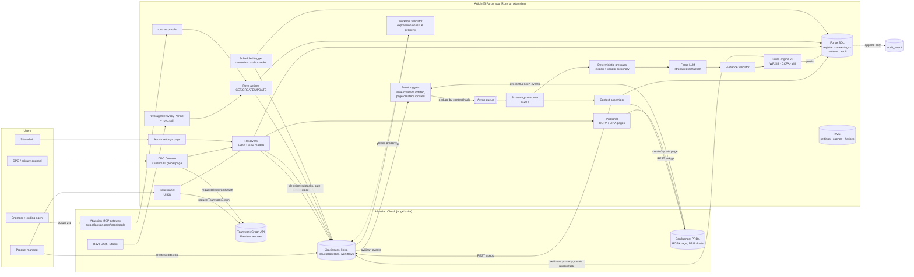

# 07 — System Architecture: Article25

**Prepared:** 2026-11-22 · **Status:** design only (nothing implemented). Items needing verification are tagged **[SPIKE Ux]** (see 05 §1.8).
Per the brief's rules this document describes architecture and conceptual data models. It deliberately contains **no source code, manifest files or DDL**.

---

## 1. Design principles
1. **Deterministic where correctness matters, AI where language matters.** The LLM produces evidence-backed signals. Rules decide outcomes.
2. **Everything traceable.** Each user-visible claim links to a source quote, a rule ID and a rules version.
3. **Human in the loop for consequences.** Register changes, page publishing, gate clearance and task creation need a human action.
4. **Runs on Atlassian.** No external egress. Data stays in Forge storage. AI via Forge LLM.
5. **Fail soft.** Each optional capability (LLM, TWG, MCP, validator) can be absent without breaking the core loop.
6. **Few moving parts.** One Forge app, one SQL schema, one queue, no external services.

## 2. System diagram



Why each component exists:
- **Triggers + queue:** decouple Jira events (fast, bursty) from screening (slow). Async allows up to 900 s versus 55 s sync (Verified).
- **Context assembler:** deterministic, explainable context (no vector search needed).
- **Pre-pass:** cheap filter (skips the LLM for clearly irrelevant tickets) and the fallback when the LLM is unavailable.
- **LLM + validator:** language understanding with hallucination control.
- **Rules engine:** legal thresholds, versioned and unit-tested.
- **Issue property + validator:** the gate, evaluated by Jira itself with no function call per transition when expression-based **[SPIKE U2]**.
- **Publisher:** keeps the Confluence register human-readable and versioned.
- **Scheduled trigger:** SLA reminders and periodic re-checks (e.g. reviews older than N days).
- **Rovo agent/skill + MCP:** the same validated services exposed conversationally and to external agents.

## 3. Frontend

**Stack:** React 18 + TypeScript for Custom UI (DPO Console). **UI Kit** for the issue panel and admin page (native look, accessible, faster to build). Atlassian Design System tokens and components (`@atlaskit/*`) for consistency. `@forge/bridge` for `invoke`, `requestJira`, `requestConfluence`, `requestTeamworkGraph` **[SPIKE U3]**, `router`, `view`.

**Component architecture (DPO Console)**
```
<App>
  <Nav tabs: Queue | Register | Screenings | Reports | Settings>
  Queue:     <ReviewTable/> <SlaBadge/> <Filters/>
  Review:    <EvidencePanel/> <RegisterDiff/> <RuleTrace/> <DecisionForm/> <ConditionsEditor/> <ReviewerSuggestions(TWG)/>
  Register:  <SystemsList/> <ActivityEditor/> <VendorTable/> <VersionHistory/> <ImportCsv/> <PublishButton/>
  Screenings:<ScreeningLog/> <ScreeningDetail/>
  Reports:   <CoverageChart/> <OutcomeBreakdown/> <TimeToDecision/> <CcpaSummary/>
  Settings:  <ScopeConfig/> <ProjectSystemMap/> <GateConfig/> <AiConfig/> <SampleDataLoader/>
```
**Issue panel:** `<StatusChip/>`, `<FindingsGroups/>` (quote highlight + source link), `<Questions/>`, `<Feedback/>`, `<RequestReview/>`, `<GateStatus/>`.

**Interaction design:** status first ("DPIA likely · Review PRIV-37 open · Gate: blocked"), then why (criteria + quotes), then what to do (answer 2 questions / wait for review / conditions to complete). Progressive disclosure for the rule trace.

**Data visualisation:** small and purposeful: coverage over time (line), outcomes by type (bar), time-to-decision (box or median). Follow the `dataviz` guidelines (accessible palette, light/dark).

**Loading/error states:** skeleton panel while screening is queued ("Screening… usually ~20 s"). Rule-based-mode banner. Explicit permission errors. Empty states with a "Load sample data" CTA.

## 4. Atlassian layer

### 4.1 Forge modules (planned)
| Module | Purpose | Priority |
|---|---|---|
| `jira:issuePanel` | Privacy check panel | P0 |
| `jira:globalPage` | DPO Console | P0 |
| `jira:adminPage` | Settings, sample data | P0 |
| `trigger` (`avi:jira:created:issue`, `avi:jira:updated:issue`) | Auto-screen | P0 |
| `consumer` + queue | Async screening | P0 |
| `function` (resolvers, screening, actions) | Backend | P0 |
| `jira:workflowValidator` (expression) | Gate | P0 (Preview; fallback soft gate) |
| `scheduledTrigger` (daily) | SLA reminders, stale checks | P1 |
| `llm` | Forge LLM | P0 (fallback deterministic) |
| `rovo:agent` + `action` (×5–7) | Privacy Partner | P0 (read + create review) |
| `rovo:skill` | Reusable `privacy-screening` skill | P1 |
| `rovo:mcp` | External agent tools | P1 |
| `trigger` (`avi:confluence:created:page`, `updated:page`) + `confluence:contentBylineItem` | PRD screening + badge | P1 |

### 4.2 Scopes (expected; confirm with `forge lint`)
`read:jira-work`, `write:jira-work`, `read:jira-user` · `read:confluence-content.all`, `read:confluence-content.summary`, `write:confluence-content`, `search:confluence`, `read:confluence-space.summary` (or their granular equivalents) · `storage:app` · TWG: `read:graph:issue:jira`, `read:graph:user:atlassian`, `read:graph:team:atlassian`, `read:graph:goal:atlassian`, `read:graph:page:confluence` (**names Unverified**; TWG scopes make installation **org-admin only**).

### 4.3 Resolvers (backend API surface)
`getIssueScreening(issueKey)` · `answerQuestions(screeningId, answers)` · `markNotApplicable(findingId, reason)` · `requestReview(issueKey)` · `listReviews(filter)` · `getReview(id)` · `decideReview(id, decision, conditions)` · `getRegister()` · `upsertActivity/Vendor/System(...)` · `importRegisterCsv(file)` · `publishRegister()` · `listScreenings(filter)` · `getReports(period)` · `getSettings()/saveSettings()` · `loadSampleData(projectKey, spaceKey)`. All enforce authorisation server-side (DPO group for console mutations).

### 4.4 Events and idempotency
- Trigger filter: in-scope project and issue type (settings), `ignoreSelf: true` (prevents loops when we write properties or comments).
- Content hash (summary + description + AC + linked-page versions) stored in KVS. Re-screen only on change.
- Queue job key = `issueKey:hash`. Review creation is idempotent by `screeningId`.

### 4.5 Storage
- **Forge SQL** for relational, reportable data (register, screenings, findings, reviews, audit).
- **KVS** for settings, content hashes, small caches (agent summaries).

### 4.6 Deployment
Environments: `development` (dev site via `forge site provision`), `staging` (optional), `production` (Sharing link for judges). Distribution = **Sharing** with privacy policy and terms URLs. A second clean site validates installation **[SPIKE U7]**.

## 5. AI layer

### 5.1 Model strategy
- **Default:** `claude-sonnet-5` via Forge LLM (active until at least 30 Jun 2027; covers judging). Configurable model ID.
- **No Haiku 4.5 dependency** (retirement window has opened).
- **Parameters:** omit `temperature`/`top_p` for models that don't support them (Verified note for sonnet-5/opus-5). Low `max_completion_tokens` (~1,200).

### 5.2 Prompt architecture
- **System prompt:** role ("privacy signal extractor"), strict instructions (extract only what the text states or clearly implies, always quote evidence verbatim, use taxonomy values only, never decide legal outcomes), taxonomy list (data categories incl. GDPR Art. 9 special categories, data subjects, purposes, transfer regions, WP248 criteria IDs).
- **User content:** delimited sections `<ISSUE>`, `<PARENT>`, `<LINKED_PAGE id=…>`, `<SYSTEM_CONTEXT>` (register summary), `<PM_ANSWERS>`.
- **Tool schema** `report_privacy_signals`: arrays of `{kind, value, evidence_quote, source_ref, confidence}` plus `open_questions[] (≤3)`.
- **Prompt-injection defence:** content treated as data. Instructions inside tickets are ignored by design (system prompt + schema-only output + validator). Outcomes come from rules, so an injected "this is fine" cannot clear a gate.

### 5.3 Validation and guardrails
1. Schema validation (reject + single retry).
2. Evidence verification: normalised fuzzy match ≥0.9 against the assembled source. Unverified items are dropped and counted.
3. Taxonomy normalisation (synonyms → canonical).
4. Confidence floor per kind (tuned on the eval set).
5. Rules engine computes outcome. LLM output never sets the outcome directly.

### 5.4 Agent architecture (Rovo)
- **Agent "Privacy Partner":** prompt focused on role and boundaries ("you explain screenings and the register; you never give legal advice; cite screening IDs").
- **Actions:**
  | Key | Verb | Purpose |
  |---|---|---|
  | `get-screening` | GET | Outcome + findings for an issue |
  | `search-register` | GET | Systems / activities / vendors lookup |
  | `list-pending-reviews` | GET | DPO queue summary |
  | `explain-requirements` | GET | What's needed before using vendor X / category Y |
  | `screen-proposal` | GET | Screen free text (fast path: pre-pass + rules; LLM if within time budget) |
  | `create-privacy-review` | CREATE | Create review task (chat confirmation) |
  | `record-decision` | UPDATE | DPO decision (DPO-only, server-side check) |
- **Skill `privacy-screening`** (P1): SKILL.md describing when and how to use the actions, how to interpret outcomes, and escalation rules. `references/` holds the taxonomy and WP248 criteria summary. Dependencies: the GET actions.
- **MCP** (P1): expose `screen-proposal`, `search-register`, `explain-requirements` (read-only) to external clients. Publish an open-source `skill.md` for third-party agents (encouraged by the rules).

### 5.5 Observability
Structured logs (screening ID, durations per stage, token counts, dropped-evidence count, outcome). App-level metrics table (daily aggregates) feeding Reports and our own eval tracking. No PII in logs (log IDs, not text).

## 6. Data layer

### 6.1 Conceptual data model (entities and relationships)
| Entity | Key attributes | Relationships |
|---|---|---|
| **System** | id, name, description, owner (accountId/team ARI), jira projects[] | has many ProcessingActivity |
| **ProcessingActivity** | id, name, purpose, lawful basis, data categories[], data subjects[], retention, transfers[], vendors[], status, version | belongs to System. Changed by RegisterChange. |
| **Vendor** | id, name, aliases[], role (processor/sub-processor/controller), DPA status, regions | referenced by activities |
| **TaxonomyTerm** | id, kind (category/subject/purpose/criterion), label, synonyms[], special flag | referenced by findings |
| **Screening** | id, source (issue/page), source key, content hash, rules version, model, outcome, created at, duration, status | has many Finding. May have one Review. |
| **Finding** | id, kind, value (taxonomy id), evidence quote, source ref, confidence, verified flag, user feedback | belongs to Screening |
| **RuleHit** | screening id, rule id, inputs, result | explains outcome |
| **Review** | id, screening id, jira review key, state, assignee, decision, conditions[], decided by/at | belongs to Screening |
| **RegisterChange** | id, review id, diff (before/after), applied by/at, published page version | versions the register |
| **AuditEvent** | id, actor, action, entity, before/after hash, timestamp | append-only |
| **Settings** | scope, mappings, gate statuses, DPO group, AI flags, caps | singleton per install |

### 6.2 Entity resolution
- **Vendors:** alias matching (case/punctuation-insensitive, known aliases, domain names). Unknown vendor names → "Unregistered vendor" finding with a quote.
- **Systems:** project→system mapping plus components/labels overrides.
- **People/teams:** TWG ARIs when available, else Jira accountIds.

### 6.3 Persistence, caching, retention
- SQL is the source of truth. KVS caches agent-ready summaries per issue (invalidated on new screening).
- Retention defaults: screenings and audit kept for 5 years (aligns with the CCPA requirement to retain assessments for the processing duration or 5 years, whichever is later; **verify the exact rule** with counsel before claiming compliance). Configurable. Purge on uninstall per Forge storage lifecycle.

### 6.4 Security
Server-side authorisation on every resolver/action (`context.accountId`, DPO group, `asUser` browse checks). No secrets. No egress. Evidence quotes are stored only for screened issues; "minimise stored text" setting (store hashes + offsets only) is a P2 option.

## 7. Failure modes and responses
| Failure | Detection | Response |
|---|---|---|
| LLM error / timeout | Exception, >60 s | Rule-based outcome + banner; retry later via scheduled job |
| Evidence mostly unverified | Dropped-evidence ratio > 50% | Outcome `NEEDS_INFO`; log for eval |
| Event storm (bulk edit) | Queue depth | Dedupe by hash; rate-limit per project |
| Confluence publish fails | API error | Keep the register change; mark "publish pending"; retry |
| Validator misconfigured | Admin page health check | Show instructions; soft-gate fallback |
| TWG empty or error | Errors or empty with missing scopes | Hide section; never treat empty as a definitive answer (Supported practitioner lesson) |
| Rovo action slow | >15 s | Return cached summary + link |
